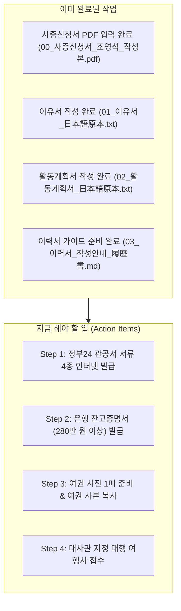

# 🇯🇵 일본 워킹홀리데이 1트 합격 수기 심층 분석 및 실전 가이드

> **참고 출처:** 네이버 블로그 [길치 깅구의 모험] - 만 27세 여성 무자격(JLPT 없음) 1트 합격 일대기 (총 6편)

---

## 1. 합격자 스펙 및 핵심 시사점

| 구분 | 합격자 스펙 | 조영석 님 스펙 (비교) | 시사점 |
| :--- | :--- | :--- | :--- |
| **연령** | 만 27세 (여) | 만 29세 (남) | 나이 제한(원칙 만 25세, 부득이한 경우 30세) 구간에서도 **당위성 있는 이유서**로 충분히 합격 가능 |
| **어학 자격** | **JLPT/JPT 없음** (고2 제2외국어 수강만) | 독학 및 전공 연계 | 자격증이 필수는 아니며, 이유서·계획서의 진정성이 당락을 좌우함 |
| **직업/전공** | 비전공 대졸, 퇴사 후 공백기 | **DN솔루션즈 재직 중** (공학 전공) | **공작기계/제조 엔지니어링 경력과 로봇공학 석사 진학 목표**는 심사관 입장에서 매우 강력한 무기 |
| **방일 이력** | 9회 (관광) | 이력 반영 예정 | 방문 횟수가 많아도 **출입국사실증명서와 100% 일치**시키면 문제없음 |
| **잔고 증명** | 1,400만 원 예치 | 280만 원 이상 준비 | 최소 기준(280만 원) 이상이면 무난히 통과 |

---

## 2. 블로그 전편(6편) 시리즈 링크 및 편별 핵심 요약

### [1편] 스펙, 사증신청서, 이력서, 조사표
🔗 [https://m.blog.naver.com/g1n9u/223974882003](https://m.blog.naver.com/g1n9u/223974882003)
* **신양식 도입 주의 (2025년 4분기부터):**
  - **이력서:** '과거 워킹홀리데이 사증 교부 이력(交付歴)' 문항 신설.
  - **조사표:** 질문 3번 '일한 워킹홀리데이 제도 참여는 처음입니까?'(처음 / 2번째) 신설.
* **작성 원칙:**
  - 컴퓨터/손글씨 모두 허용되나, **최종 서명란은 반드시 출력 후 검은 펜으로 정자 자필 서명**.
  - 날짜는 반드시 **일/월/년 (DD/MM/YYYY)** 순서.
  - 이력서 특기란은 절대 비워두지 말고 `JLPT 준비중(準備中)` 등으로 채울 것.

---

### [2편] 이유서, 계획서 내용 및 파일 공유 (feat. 이라스토야)
🔗 [https://m.blog.naver.com/g1n9u/223974913817](https://m.blog.naver.com/g1n9u/223974913817)
* **이유서 필승 4단 구성 공식:**
  1. **계기:** 일본 모노즈쿠리(장인·제조 문화) 및 전통 문화에 관심을 갖게 된 계기.
  2. **이유:** 왜 유학/관광비자가 아닌 '워킹홀리데이'여야 하는가? (자유로운 4계절 전국 이동).
  3. **계획:** 무엇을 보고 체험할 것인가?
  4. **귀국 후 활용 (절대 원칙):** **1년 후 반드시 한국으로 완전 귀국**하여 대학원 진학에 활용할 계획 명시.
* **금기 사항:** 취업 목적, 현지 영주/정착 뉘앙스는 절대 배제.
* **디자인 팁:** 일본 감성의 무료 저작권 프리 일러스트 [이라스토야(いらすとや)](https://www.irasutoya.com)를 활용하여 사계절 아이콘 배치 시 정성 평가 상승.

---

### [3편] 관공서 서류 (기본증명서, 주민등록초본, 학력증명서, 출입국사실증명서)
🔗 [https://m.blog.naver.com/g1n9u/223974922000](https://m.blog.naver.com/g1n9u/223974922000)
* **정부24 및 전자가족관계등록시스템 무료 발급 (최근 3개월 이내):**
  - **기본증명서 & 가족관계증명서:** 반드시 **'상세'** 선택.
  - **주민등록초본:** 주소 변동 내역 및 병역 사항 포함 필수.
  - **출입국사실증명서:** 기간 설정을 반드시 **'출생일 ~ 신청 당일'** 전체로 지정.

---

### [4편] 잔고증명서, 여권 사본, 체크리스트 (feat. 농협/카뱅)
🔗 [https://m.blog.naver.com/g1n9u/223974930205](https://m.blog.naver.com/g1n9u/223974930205)
* **잔고증명 간소화 (중요):**
  - 과거의 '3개월치 거래내역서'는 불필요하며, **본인 명의 '잔고증명서 1장'**으로 간소화됨.
  - 잔고 280만 원 이상 (원화 기준 발급). 제출일 기준 1개월 이내 발급분.
* **여권 사본:** 인적사항면 + 과거 일본 출입국 스탬프가 찍힌 전 페이지 선명하게 복사.

---

### [5편] 대행사 방문기 (부산한일문화교류협회)
🔗 [https://m.blog.naver.com/g1n9u/223974935322](https://m.blog.naver.com/g1n9u/223974935322)
* **대리신청기관 필수:** 서울/부산 관할 거주자는 영사관 직접 창구 접수가 불가능하며, 대사관/영사관 지정 대행 여행사를 통해서만 접수 가능.
* 창구 직원이 서류 누락 여부를 1차로 꼼꼼하게 사전 검수해 줌.

---

### [6편] 합격 발표, 여권 제출, 워홀 비자 수령 (feat. 우체국 등기)
🔗 [https://m.blog.naver.com/g1n9u/223992627350](https://m.blog.naver.com/g1n9u/223992627350)
* 합격 당일(오전 9시 30분경) 대사관 홈페이지 접수번호 공지 확인.
* 합격 후 대행사로 **실물 여권**을 우체국 익일특급 등기로 발송.
* 비자 스티커가 부착된 여권을 수령하면 완료.

---

## 3. 현재 준비 상태 및 향후 Action Item

